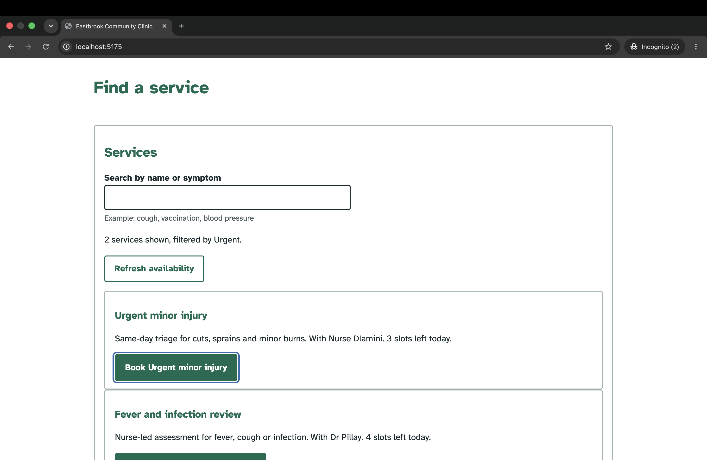
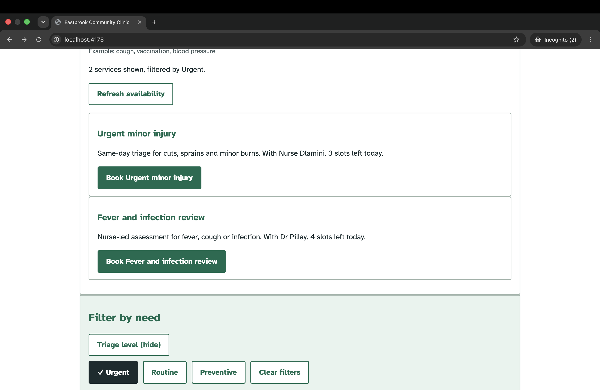
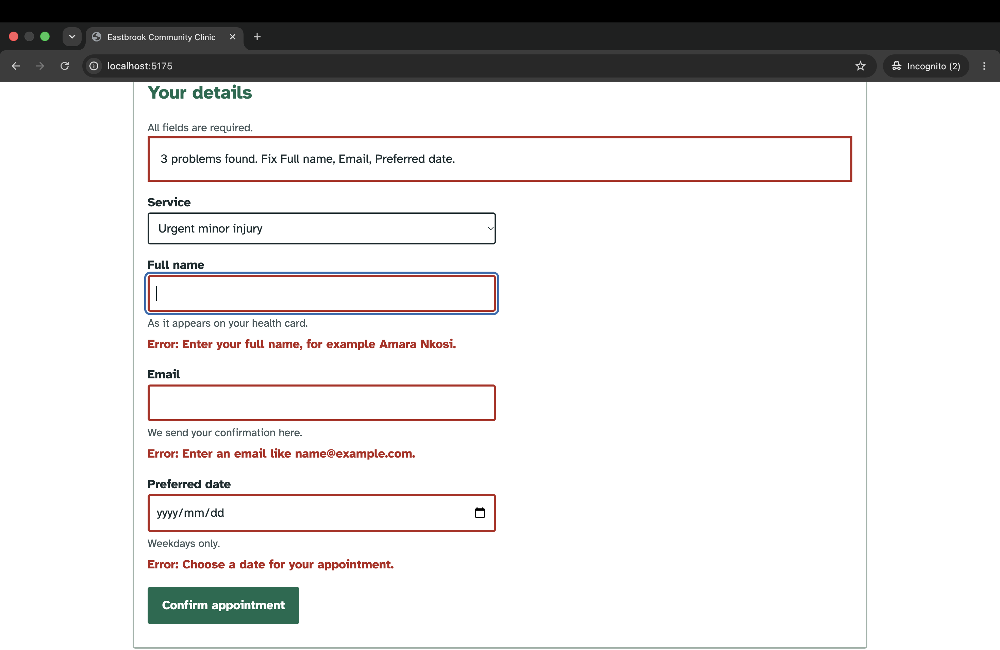
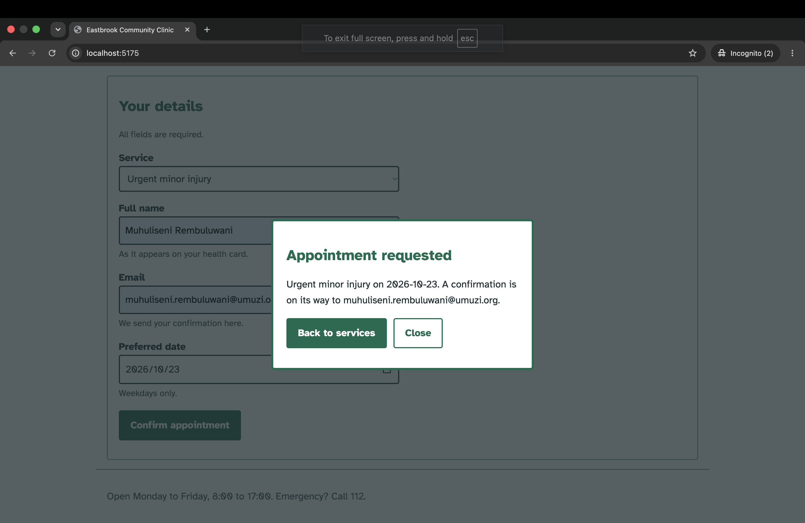
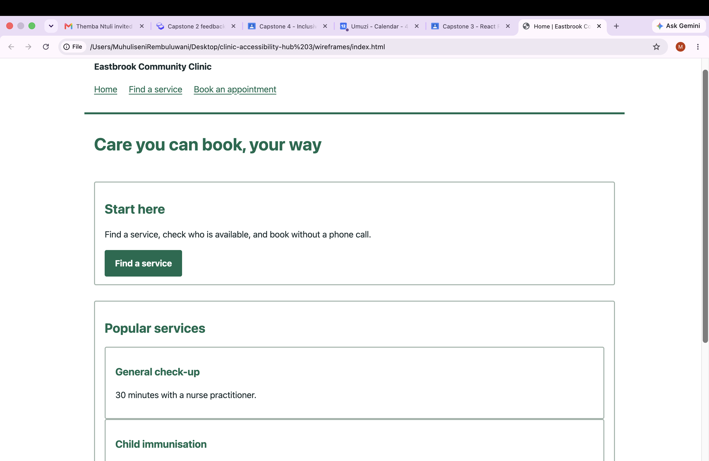
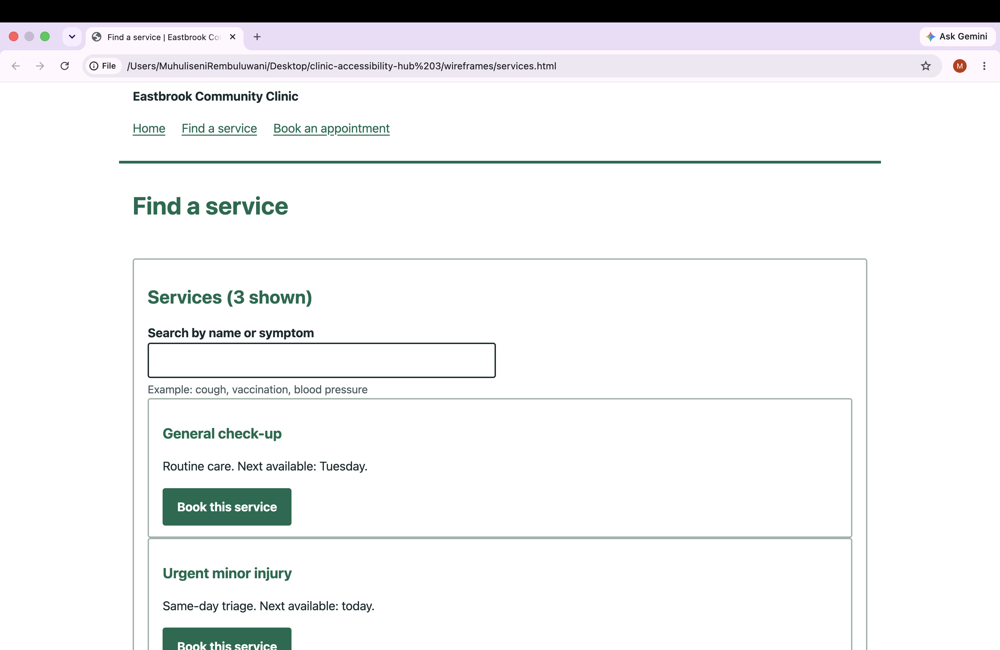
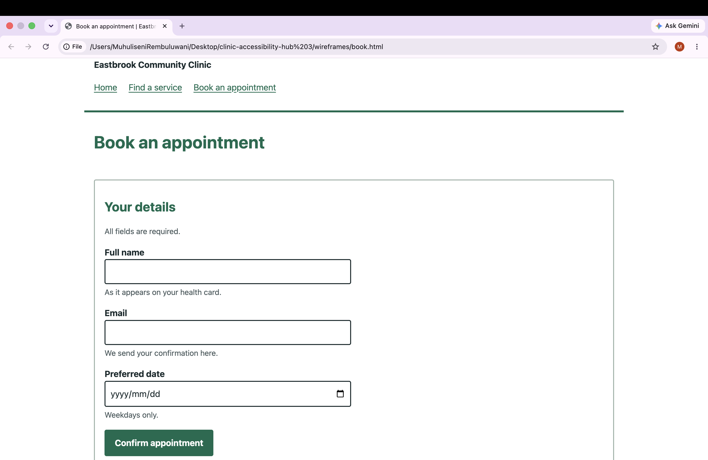
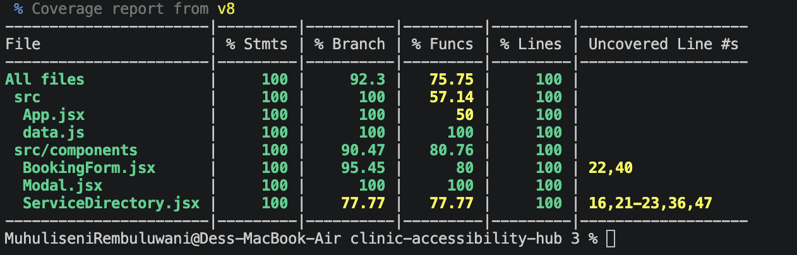

# Testing log

Tester: _your name_ · Date: _date_ · Browser: Safari (VoiceOver), Chrome (Lighthouse)

## 1. Automated results (12 Oct 2026)
| Tool | Result | Scope |
|---|---|---|
| Vitest + Testing Library | 13 of 13 passing | Components, ARIA state, focus |
| axe-core | 0 violations | Directory; booking form in error state |
| Lighthouse 13.4.1 | 100 / 100 / 100 / 100 | Directory view (Performance, Accessibility, Best Practices, SEO) |
| Coverage (v8) | 100% lines, 92% branches | `src/` |
| `npm audit --omit=dev` | 0 vulnerabilities | Production dependencies |

Screenshots: `../screenshots/lighthouse.png`, `../screenshots/coverage.png`

## 2. Keyboard tab sequence (no mouse)

**Method:** Tested with keyboard only (Tab, Shift+Tab, Enter, Space, Escape), no mouse or trackpad, in Chrome on macOS using the local build, on 12 Oct 2026. Each row was compared against the expected behaviour from the component design.

### Directory page
| # | Press | Expected focus / behaviour | Result |
|---|---|---|---|
| 1 | Tab | "Skip to main content" link appears and takes focus | ✔ Matched |
| 2 | Tab | Find a service (nav button) | ✔ Matched |
| 3 | Tab | Book an appointment (nav button) | ✔ Matched |
| 4 | Tab | Search by name or symptom | ✔ Matched |
| 5 | Tab | Refresh availability | ✔ Matched |
| 6-11 | Tab ×6 | The six "Book…" buttons, in visual order | ✔ Matched |
| 12 | Tab | Triage level (show/hide) | ✔ Matched |
| 13 | Enter | Panel opens; button text changes to "hide"; Tab then reaches Urgent, Routine, Preventive | ✔ Matched |
| 14 | Space on Urgent | Button turns dark with a tick; count line updates to "filtered by Urgent" | ✔ Matched |
| 15 | Enter on Refresh availability | Results update; keyboard focus stays on the button | ✔ Matched |

### Booking page
| # | Press | Expected behaviour | Result |
|---|---|---|---|
| 1 | Enter on a Book button | View changes; heading "Book an appointment" receives focus | ✔ Matched |
| 2 | Tab | Service, Full name, Email, Preferred date, Confirm appointment, in that order | ✔ Matched |
| 3 | Enter on Confirm with an empty form | Error summary appears; focus moves to Full name | ✔ Matched |
| 4 | Submit a valid form | Confirmation popup opens; focus lands on "Back to services" | ✔ Matched |
| 5 | Tab / Shift+Tab inside the popup | Focus cycles between the two popup buttons only | ✔ Matched |
| 6 | Escape | Popup closes; focus returns to "Confirm appointment" | ✔ Matched |

### Summary
- **Operability:** Every control was reachable with Tab and operable with Enter or Space.
- **Focus visibility:** A blue 3px focus ring was visible on every focused element.
- **Order:** Tab order followed the visual order on both pages, with no jumps.
- **Keyboard traps:** None found. The popup contains focus while open, but Escape always exits it.
- **Focus management:** Focus moved to the new page heading on view change, to the first invalid field after a failed submit, and back to the opening button when the popup closed.

Behaviours 3 to 6 on the booking page are also covered by automated tests in `src/test/`.

## 3. VoiceOver (macOS, Safari)

**Method:** Tested with VoiceOver on macOS in Safari, using the local build, on 12 Oct 2026. The VO key is Control+Option. Each row compares the announcement heard against the expected announcement from the component design. Only this one screen reader and browser pairing was tested manually; NVDA and Orca were not available.

| # | Check | What I did | Expected announcement | Result |
|---|---|---|---|---|
| 1 | Landmarks | VO+U, then the Landmarks list | Banner, navigation, main, search, complementary ("Filter by need"), and footer are all listed | ✔ Matched |
| 2 | Filter accordion | Focused "Triage level", pressed VO+Space | Button announced as collapsed, then as expanded after activation | ✔ Matched |
| 3 | Filter toggle | Focused "Urgent", pressed VO+Space | Announced as a toggle button, with its state changing to on | ✔ Matched |
| 4 | Result count | Waited after filtering | "2 services shown, filtered by Urgent" is spoken without moving focus | ✔ Matched |
| 5 | Availability refresh | Activated "Refresh availability" | "Updating availability..." is spoken, then "Availability updated. 6 services changed." | ✔ Matched |
| 6 | Form errors | Submitted the empty booking form | "3 problems found..." is read out; focus lands on "Full name", announced as invalid with its error text | ✔ Matched |
| 7 | Modal | Submitted a valid form, then pressed Escape | Announced as a dialog titled "Appointment requested", focus on "Back to services"; Escape closes it | ✔ Matched |

### Summary
- **Landmarks:** The page structure was fully navigable by landmark, so a screen reader user can jump straight to search, filters or the main content.
- **State:** `aria-expanded` and `aria-pressed` changes were announced as soon as the buttons were activated.
- **Live regions:** The polite status messages (result count, availability updates) were announced without moving focus, and the assertive alert on a failed submit was announced immediately.
- **Forms:** Labels, helper text and errors were read together on the focused field.
- **Dialog:** The confirmation was announced as a dialog and focus stayed inside it until it was closed.
- **Issues found:** None.

### Limitations
Testing covered VoiceOver with Safari only. Results in NVDA with Firefox or Orca on Linux may differ in verbosity, so cross-reader testing is a recommended next step before a production release.

## 4. Screenshots

## 5. Reflection
The hardest part was making dynamic changes understandable without sight, because the same filter button can be correct visually and still say nothing useful to a screen reader. Tying `aria-expanded`, `aria-pressed`, `aria-busy` and the live regions directly to React state meant the announcements always matched what was on screen. Manual testing caught two bugs that the automated tests missed: the filter panel never hid, and a pressed filter did not darken, both caused by CSS overriding the `hidden` attribute and the pressed style. That showed me that axe-core and Lighthouse can report 100 while real usability problems remain, so they are a floor and not proof of accessibility. I would test with NVDA and a real screen reader user next, and add visible loading text for the availability refresh. The biggest thing I learned is to design for the keyboard and screen reader first and treat the visual layer as an addition to that foundation.
